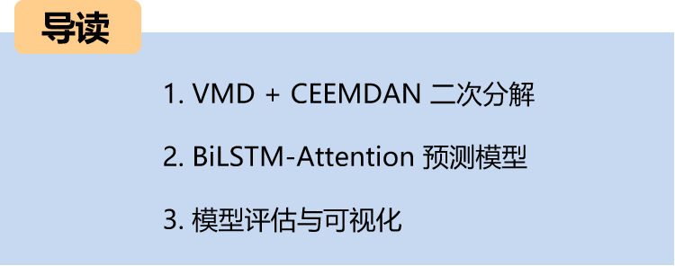
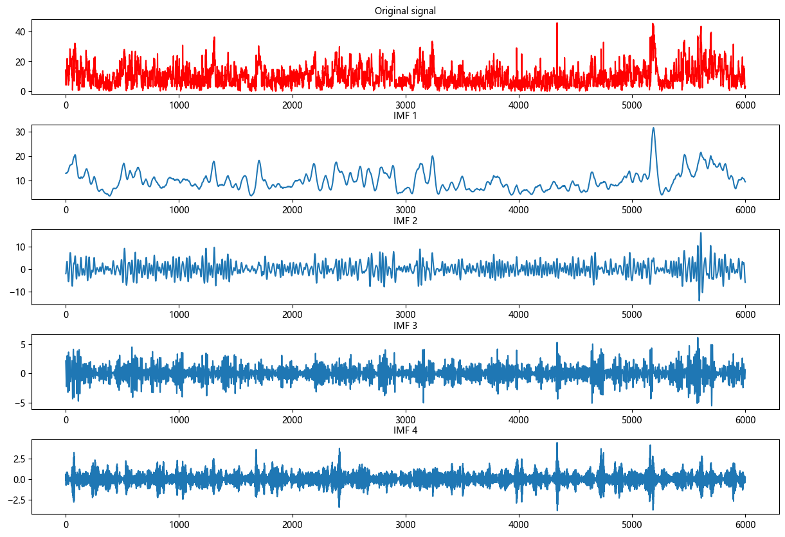
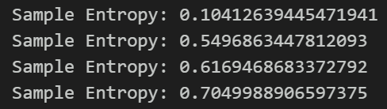
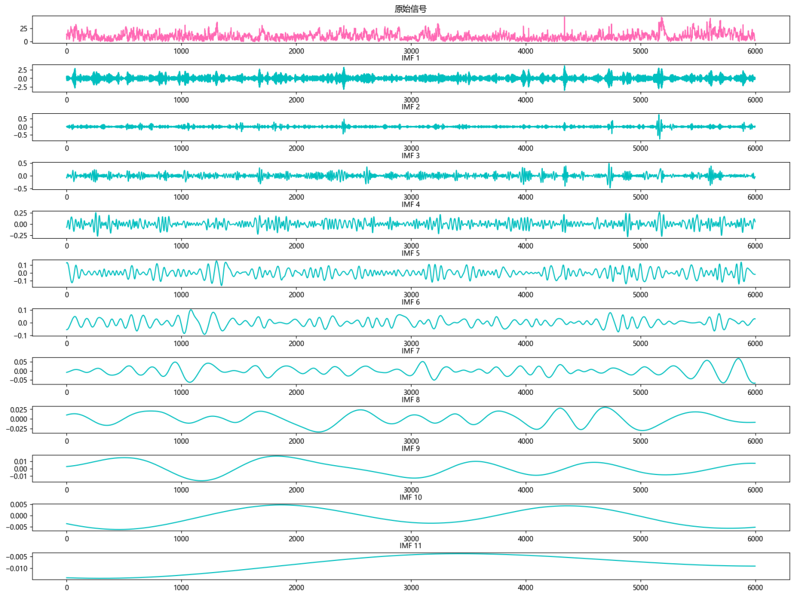
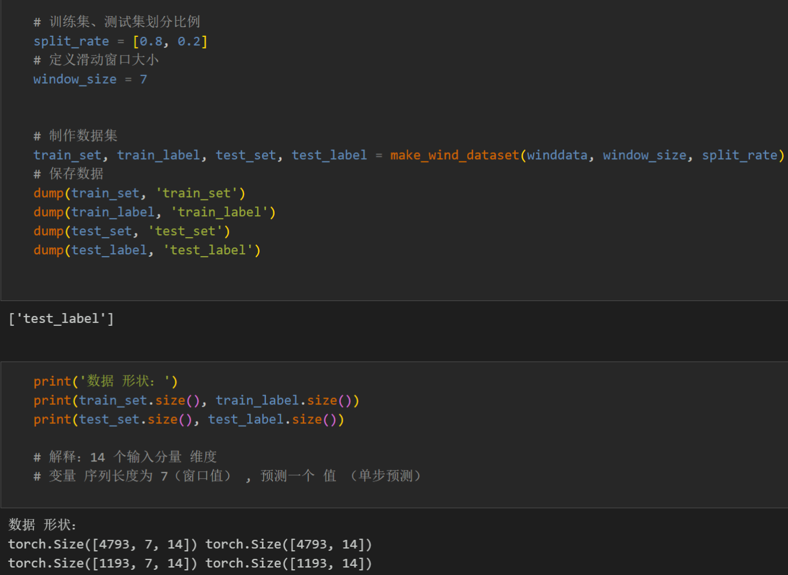
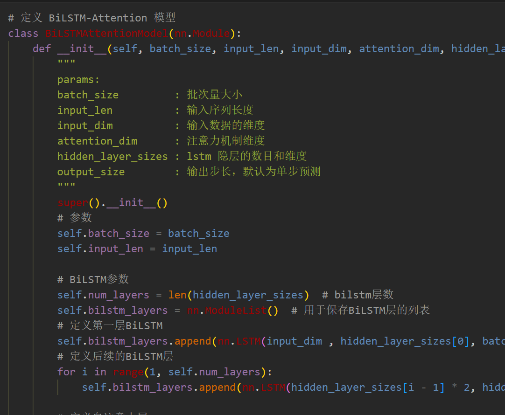
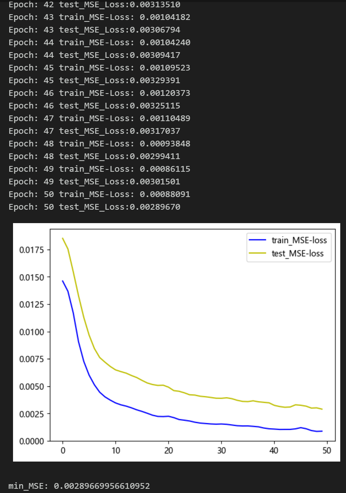
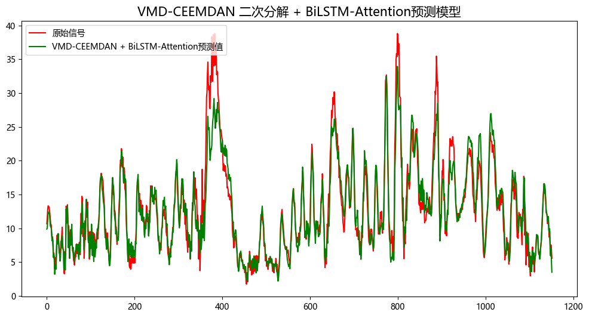
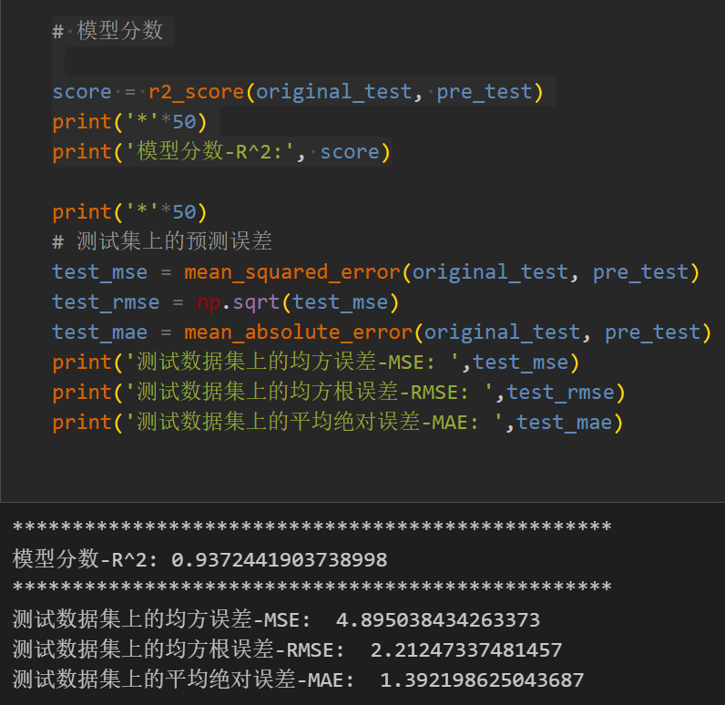
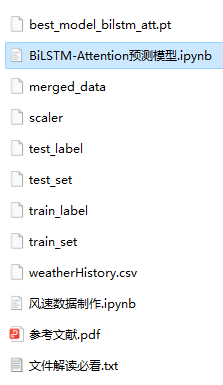

# VMD + CEEMDAN Second Decomposition, BiLSTM-Attention Prediction Model

Innovation Points: Secondary decomposition + Attention model including wind speed data, as well as pre-generated and ready-made wind speed dataset and label set, corresponding codes can be run.
VMD + CEEMDAN secondary decomposition, BiLSTM-Attention prediction model, with smaller MSE, MAE, and the effect is particularly obvious, significantly improved! 
Includes data preprocessing code and secondary decomposition code, and complete BiLSTM-Attention model prediction code, visualization code.
Preface:
This article introduces a BiLSTM-Attention prediction model based on VMD+CEEMDAN secondary decomposition, which improves the predictive performance of time series data.
1. Secondary Decomposition and Data Set Creation:
1.1 Importing Data
1.2 VMD Decomposition
Firstly, observe the center frequency under different K values conditions to select the K value; from K=4, there are similar center frequencies in the modes, indicating overdecomposition, so choose the number of modes K as 4.
Secondly, decomposition visualization
1.3 Entropy of samples
Entropy is a method for measuring the complexity of a sequence, which can evaluate its complexity by calculating uncertainty in the sequence. The higher the entropy, the greater the complexity of the sequence. 
Through the calculation of sample entropy of the four components after VMD decomposition, the residual component IMF4 has richer uncontrollable information, and further extract effective information from IMF4 of VMD's residual component, conduct CEEMDAN decomposition on IMF4.
1.4 CEEMDAN Decomposition
Conduct re-decomposition on the last residual component after VMD decomposition
1.5 Data Set Creation
Firstly, merge the components after VMD and CEEMDAN decomposition, divide training set and test set according to 8:2 ratio
2. Prediction Model Based on Pytorch's BiLSTM-Attention
2.1 Define the BiLSTM-Attention prediction model
Note: The input wind speed data shape is [64, 7, 14], batch_size=64, where 7 represents the sequence length (the sliding window takes values), and the dimension of 14 represents the dimension of the merged components.

2.2 Set parameters and train the model
50 epochs, MSE is 0.002896, the BiLSTM-Attention prediction effect with VMD+CEEMDAN secondary decomposition is good. After secondary decomposition, more information can be extracted from the sequence, and the prediction effect is significantly improved, showing superior performance. By appropriately adjusting model parameters, further improvement in model prediction performance can be achieved.
Note to adjust parameters:
- Modify the number of BiLSTM layers and each layer's dimension;
- Adjust the number of attention hidden layer dimensions, increase more epochs (note to prevent overfitting);
- Change the sliding window length (set a suitable window length).
3. Model Evaluation and Visualization
3.1 Results Visualization
4.2 Model Evaluation

## Images

<!-- PAYMENT_BLOCK -->

## Get this dataset

- Payment link (Stripe): [Buy now](https://buy.stripe.com/3cs8yP7sY87d0vu9AB)
- Payment QR code: 

<!-- /PAYMENT_BLOCK -->
